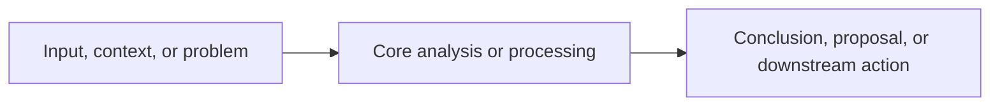

# Fast AI Doc

## Purpose

Write Markdown that engineers, product managers, operators, testers, and reviewers can read, challenge, and act on. Let readers understand the subject, current conclusion or decision, impact, and main flow before expanding into details.

## Use when

Use this skill to create, complete, or revise:

- technical designs, architecture, API, or data-model documents;
- research reports, option analyses, conclusion documents, and incident reviews;
- change proposals, migration plans, release plans, and implementation plans.

Unless the user explicitly asks for an intentionally minimal notice or changelog, every document must include a Markdown table and a Mermaid diagram.

## Before writing

1. Read only user-named material and the direct dependencies needed to write accurately. Reuse established terminology, API names, paths, and facts.
2. Keep these categories distinct:
   - **confirmed fact**: supported by code, configuration, contracts, production records, test results, research material, or explicit user input;
   - **decision or conclusion**: selected by requirements, review, or known material;
   - **hypothesis or open item**: lacks a responsible owner, dependency, data point, or validation result.
3. Do not guess. Ask the smallest necessary question when a missing premise changes the document's conclusion; otherwise record it under risks and open items.

## Required structure

Use this structure unless the user explicitly requests another one. Remove irrelevant optional sections rather than adding empty text. A table of contents, a Markdown table, and a Mermaid diagram are mandatory.

```markdown
# <Title>

## Table of contents

- 1. Summary and key conclusions
  - 1.1 <Feature / flow / architecture / evaluation overview>
- 2. Background, problem, and scope
- 3. <Facts, current state, or core design>
- 4. <Analysis, proposal, or key rules>
- 5. <Contracts, data, evidence, or comparison>
- 6. Risks, boundaries, and open items
- 7. Change scope / action items
- 8. Release, implementation, or validation plan
- 9. Acceptance criteria / appendix

## 1. Summary and key conclusions

> **Required order: this chapter must contain summary prose, at least one Markdown table, and one Mermaid overview diagram. Do not omit either artifact or move it to another chapter as a substitute.**

<One to three paragraphs explaining the subject, established conclusion or decision, primary impact, and explicit exclusions.>

### 1.1 Key conclusion table (required)

| Dimension / system / conclusion | Key conclusion, current state, or change | Evidence, impact, and boundary |
| --- | --- | --- |
| <item> | <traceable fact or decision> | <source, caller, condition, or non-goal> |

### 1.2 Overview diagram (required)



## 2. Background, problem, and scope

### Known background / facts

<Current state, problem, and constraints; each is traceable.>

### Goals / questions to answer

1. <A goal or question whose result can be evaluated>

### Non-goals / out of scope

- <An explicitly excluded item>
```

## Chapter-one rules

Chapter one must contain, in order, summary prose, at least one Markdown table, and one Mermaid overview diagram. These artifacts are mandatory and must stay in chapter one regardless of document type, length, or incomplete information. When information is incomplete, show known facts and open items in the table, and show only the confirmed primary flow or analysis path in the diagram.

A reader of the first two screens should be able to answer:

1. What the document covers and its current conclusion, decision, or key finding;
2. Which systems, interfaces, data, flows, or roles are affected;
3. How the end-to-end flow, component responsibilities, or analysis path connects;
4. What capabilities, questions, or scope are explicitly excluded.

Adapt chapter-one labels and table columns to the document type instead of always using "key conclusions":

| Document type | Suggested chapter-one title | Suggested table columns |
| --- | --- | --- |
| Technical design, change, API design | Decision summary / proposal summary | System or change, decision, impact and boundary |
| Research, option analysis, conclusion | Findings / research summary | Finding, evidence, applicability boundary |
| Incident or problem review | Incident summary / review conclusions | Finding, evidence, mitigation or follow-up |
| Implementation, release, migration | Implementation summary / release conclusion | Stage, change, prerequisite, and risk |

- Use real business actions, stable components, or observed events as diagram nodes. Arrows represent actual data, control, causal, or analysis direction.
- Do not invent services, queues, states, or root causes for visual appeal. Put complex branches in later local diagrams; keep the first diagram to the main path.
- Keep Mermaid consistent with the text, contracts, data flow, and conclusions.

### Mermaid line-break rule

- Use HTML `<br/>` for line breaks in Mermaid nodes, edge labels, and annotations, for example `A[Upload completes<br/>server validation begins]`.
- Do not use literal `\n`, `\\n`, or source-line breaks to represent a line break inside Mermaid text. Renderers may display those characters or reject the diagram.
- Prefer shorter labels. When a label still needs multiple lines, use `<br/>` rather than escape sequences.

## Body rules

1. **Background, problem, and scope:** state current conditions, problem, goals, non-goals, and external constraints.
2. **Facts, design, or analysis:** follow the reader's main path. Designs cover responsibilities, inputs, outputs, rules, failure handling, and boundaries. Research and reviews show the relationship between observations, evidence, method, and conclusions.
3. **Contracts, data, and evidence:** for APIs, events, schemas, storage objects, permissions, logs, tests, or external materials, state exact names, sources, conditions, and limitations. Do not assume an interface or capability exists.
4. **Options and trade-offs:** when alternatives exist, state the decision criteria, known evidence, rejection rationale, and applicability boundaries. Do not present an unvalidated inference as a conclusion.
5. **Change scope and action items:** organize required and explicitly unnecessary changes by system, repository, or role. Mark ownership or dependencies as open when unknown.
6. **Release, implementation, or validation:** describe sequence only when a real dependency exists. State prerequisites, compatibility windows, validation method, and rollback concerns.
7. **Acceptance criteria:** use observable behavior, API responses, stored data, logs, test records, or manual checks. Map each item to a chapter-one conclusion and body rule.

## Evidence, numbers, and commitments

The document must withstand review; do not manufacture precision.

- Do not invent test coverage, performance gains, QPS, latency, capacity, success rate, cost, rollout scale, dates, root causes, or "validated" results.
- State a number only when a source, test conditions, observation window, or explicit user-provided fact supports it. State relevant limitations too.
- Distinguish target values, recommendations, heuristics, hypotheses, and measurements. For example, write "determine the threshold after load testing," not "the system supports 99.9% availability."
- Use "planned," "proposed," "to be validated," or "open" for unfinished capability. Do not state it as an established fact.
- Do not use "should," "expected," or "could" as acceptance criteria. Acceptance criteria must be decidable outcomes with necessary prerequisites.
- Do not assume implementation details, dependent-system capabilities, permissions, or operational guarantees. Record unknown prerequisites as risks or open items.
- In reviews, distinguish direct evidence, reasonable inference, and unconfirmed hypothesis. Do not claim causation from correlation alone.

## Completion checklist

- [ ] The table of contents matches the document hierarchy.
- [ ] Chapter one contains the document-type-specific summary, at least one Markdown table, and one Mermaid overview diagram; the table and diagram are both in chapter one.
- [ ] Terms, facts, and boundaries agree across diagrams, tables, and prose.
- [ ] Mermaid line breaks use `<br/>`; Mermaid text contains no literal `\n` or `\\n`.
- [ ] Confirmed facts, decisions, hypotheses, and open items are not conflated.
- [ ] No unsupported numeric claim, performance or coverage claim, root-cause claim, or absolute commitment appears.
- [ ] Goals, non-goals, failure handling, compatibility, risks, and action items cover the actual problem.
- [ ] Acceptance criteria or follow-up actions are observable rather than vague.

## Delivery

- For a new document, produce a readable complete draft from known information and consolidate non-blocking gaps under risks and open items.
- For an existing document, preserve confirmed facts and established sections where possible; reorganize and fill only what the required structure needs.
- Briefly state the document path, chapter-one conclusion, and open items. Do not claim validation that was not actually performed.
